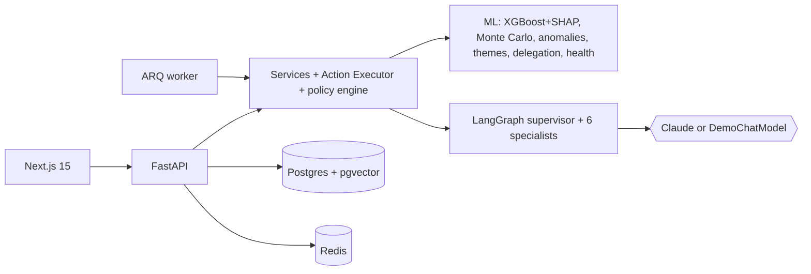

# TwinPM

> **TwinPM doesn't just answer questions about your program. It runs it the way you would,
> and shows its reasoning every time.**

TwinPM is an AI digital twin for Technical Program Managers and Technical Product Managers.
It keeps a live model of the **program** (people, skills, work, dependencies, risks,
decisions, documents) and of the **TPM** (priorities, tone, risk tolerance, escalation rules,
and how they accept, edit or reject suggestions). On top of that it watches delivery signals,
predicts problems with ML, simulates options with Monte Carlo, recommends and delegates work,
drafts communications, and acts within a TPM-controlled autonomy policy. Every action is
explained, cited and audited.

## Quick start

Requirements: Docker (with Compose), GNU Make. Optional: an Anthropic API key.

```bash
git clone <repo> twinpm && cd twinpm
make demo
```

`make demo` builds and starts the stack (Postgres + pgvector, Redis, API, worker, web), seeds
the NovaPay demo org, trains the models and prints the login URL (default
`http://localhost:3100/login`) and credentials (`priya@novapay.example` /
`SEED_DEMO_PASSWORD`, default `TwinPM-demo-2026!`).

Without `ANTHROPIC_API_KEY` everything runs offline in **demo mode**: a deterministic
`DemoChatModel` drives the same LangGraph agents from real computed data. Put your key in
`.env` (copy `.env.example`) to use Claude.

### Local development

```bash
cp .env.example .env && cp .env.example apps/api/.env
make install     # uv sync, embedding model download, pnpm install
make dev         # Postgres/Redis in Docker; API, worker and web with reload
make seed train  # demo data and models
make test lint   # backend + frontend tests, ruff, mypy --strict, eslint, tsc
make e2e         # Playwright demo flow against the running stack
make eval        # agent evals (Claude when a key is set)
```

## What's inside

| Area | Highlights |
|---|---|
| Command Center | Health score with drivers and trend, ranked morning briefing, forecast band, approvals, activity |
| Strategy | Feedback themes (MiniLM + clustering), opportunity scoring, streamed PRDs, devil's advocate, OKRs |
| Roadmap | Now/Next/Later with RICE/WSJF, drag and drop, what-if simulator, epic breakdown with ML estimates |
| Delegation | Workload heatmap, explainable owner ranking, rebalance plans with forecast impact, nudges |
| Risk Radar | Dependency graph with critical path, slip cascades, SHAP-explained delay risk, risk register |
| Comms Studio | Status reports in the TPM's voice, transcript extraction, decision log, meeting prep |
| Insights | Metric explorer with anomalies, team-level health, natural-language metric questions |
| Settings | Persona, autonomy dial (L1–L4), twin learning, integrations, members, AI usage, API tokens |
| Platform | MCP server at `/mcp`, SSE live updates, OpenTelemetry, Prometheus, Helm chart |

## Architecture



Details: [ARCHITECTURE](docs/ARCHITECTURE.md) · [AGENTS](docs/AGENTS.md) · [ML](docs/ML.md) ·
[API](docs/API.md) · [SECURITY](docs/SECURITY.md) · [DATA DICTIONARY](docs/DATA_DICTIONARY.md) ·
[DEMO SCRIPT](docs/DEMO_SCRIPT.md) · [ROADMAP](docs/ROADMAP.md) · [ADRs](docs/adr) ·
[PLAN](docs/PLAN.md)

## How this maps to enterprise needs

- **Multi-tenant by construction**: every query goes through a tenant-scoped repository; a test
  proves cross-tenant reads and writes fail.
- **Human in control**: a deterministic autonomy policy (L1 observe → L4 autonomous) gates
  every twin action; status reports and roadmap changes are capped at approval; the LLM can't
  raise its own permissions (tested). Approvals pause LangGraph runs durably in Postgres and
  survive restarts.
- **Explainable and grounded**: predictions return SHAP drivers; answers carry validated
  citations; unknown IDs are stripped.
- **Auditable**: an append-only audit log (enforced by a database trigger) records every state
  change and twin action with before/after.
- **Secure**: Argon2, rotating refresh tokens with reuse detection, CSRF protection, RBAC on
  every route, rate limits, security headers, encrypted integration secrets, PII redaction
  before LLM calls, prompt-injection fencing.
- **Private**: team-level signals only (minimum group of 5); no individual productivity scores;
  protected attributes never reach the delegation ranker.
- **Integrable**: typed connector interfaces with mock and live Jira/GitHub/Slack adapters; an
  MCP server so Claude and other clients can query the twin; an MCP client seam for vendor
  servers.
- **Operable**: health/readiness probes, Prometheus metrics, OpenTelemetry traces, structured
  logs with request IDs, LLM cost telemetry, Helm chart with prod values, CI on GitHub Actions.

## Screenshots (to capture)

1. Command Center (light and dark)
2. Ask the Twin answering "What should I do?" with the agent trace
3. Risk Radar critical path with a 9-day slip cascade
4. Delegation rebalance plan with factor bars
5. Comms Studio executive update with citations
6. Settings → Autonomy dial

## Tech stack

Next.js 15, React 19, TypeScript (strict), Tailwind v4, Radix UI, TanStack Query, Zustand,
Recharts, React Flow · Python 3.12, FastAPI, Pydantic v2, SQLAlchemy 2 (async), Alembic,
LangGraph 1.2 + langchain-anthropic, scikit-learn, XGBoost, SHAP, NetworkX,
sentence-transformers · Postgres 16 + pgvector, Redis 7, ARQ · pytest + testcontainers,
Vitest, Playwright · Docker Compose, Helm, GitHub Actions.
