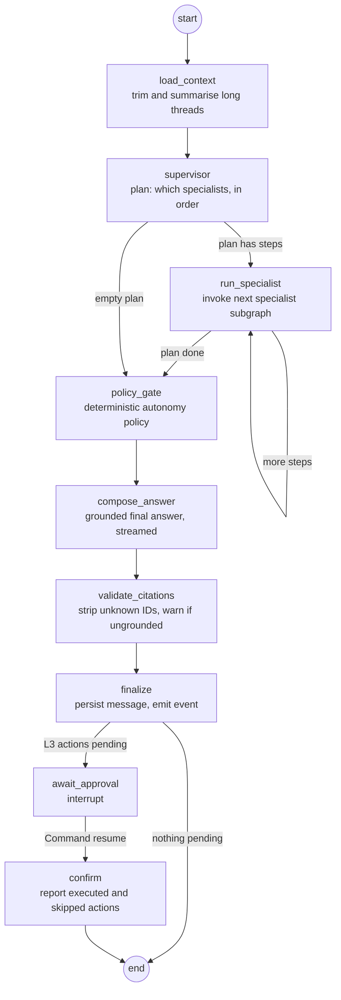
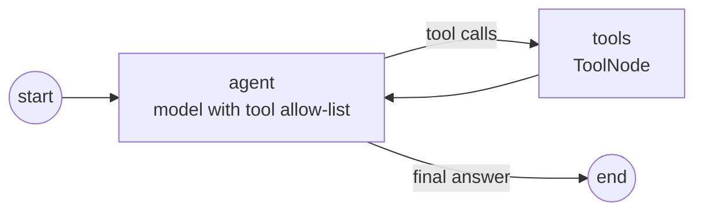
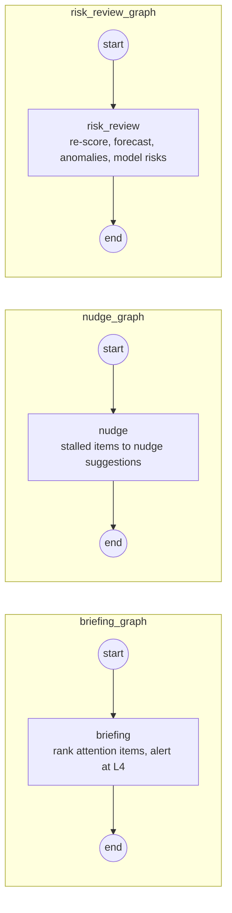

# Agents

All agent code lives in `apps/api/twinpm/agents/`. Graphs run inside the API (chat) and the
ARQ worker (background graphs). See ADR 0002 for why LangGraph.

## Supervisor graph (`graphs/supervisor.py`)

- **State** (`TwinState`): messages, question, page context, plan and step, findings per
  specialist, agent trace, citations, proposed actions, suggestion IDs, pending approval,
  answer, warnings. Thread ID = `{org_id}:{conversation_id}`.
- **Policy gate**: each proposed action goes to `services.suggestions.create`, which asks
  `services.policy` for the level. L1 notifies only, L2 makes a pending suggestion, L3 makes a
  suggestion and pauses the graph at `await_approval`, L4 executes through the Action Executor
  with undo available. Status reports and roadmap changes are capped at L3.
- **Resume**: `POST /suggestions/{id}/respond` runs the action, then the runtime hook resumes
  the thread once no suggestion in it is still pending.
- **Reliability**: retry policies on LLM nodes, a 90 s timeout per specialist, recursion limit
  40, and specialist failures degrade to a message plus the partial trace.

## Specialist subgraph (`graphs/specialist.py`)

| Agent | Tools |
|---|---|
| strategy | search_feedback, get_themes, score_opportunity, get_objectives, rag_search, draft_document |
| planner | get_epic, estimate_effort, get_capacity, compare_options, simulate_scenario, get_roadmap |
| delegation | get_workload, rank_candidates, propose_reassignment, propose_rebalance, find_stalled_items, propose_nudge |
| risk | get_risky_items, explain_prediction, get_dependency_graph, impact_analysis, run_forecast, propose_risk_update |
| comms | get_program_snapshot, get_health, rag_search, search_decisions, extract_actions, propose_status_report, log_decision |
| insights | query_metric (parameterised), get_anomalies, get_team_health |

## Background graphs (`graphs/background.py`)

## Tools

Every tool has a Pydantic input schema and returns `{data, citations: [{type, id, label}]}`.
Tenant context comes from the run config (`configurable.ctx`), never from model arguments.
Write tools never write: they return `proposed_action(s)` for the policy gate.

## Grounding and guardrails (`guardrails.py`)

- Prompts require naming the entities behind every claim; `validate_citations` keeps only IDs
  that exist in the tenant and warns when a long answer has none.
- Emails and phone numbers are redacted before any model call (`Redactor`) and restored only
  where the caller may see them.
- Document, feedback and decision text is wrapped in `<untrusted_content>` with an explicit
  instruction never to follow it; embedded closing tags are neutralised. A test plants an
  injected document and checks nothing executes and no autonomy changes.

## Models (`llm/`)

`get_chat_model(purpose)` returns `ChatAnthropic` (`ANTHROPIC_MODEL`, default
`claude-sonnet-5-5`; supervisor and final answer use `ANTHROPIC_MODEL_ORCHESTRATOR`, default
`claude-opus-5-5`) or `DemoChatModel` when no key is set or `DEMO_MODE=true`. Every call is
recorded in `llm_calls` (tokens, latency, cost estimate) by `LlmCallLogger`; admins see it at
`GET /admin/ai-usage`.

## MCP

- **Server**: `/mcp` (streamable HTTP), authenticated with per-user API tokens
  (`POST /api-tokens`). Tools: program_health, briefing, risky_items, forecast,
  search_decisions, propose_reassignment (through the policy gate). DNS-rebinding protection is
  on; allowed hosts come from `MCP_ALLOWED_HOSTS`.
- **Client seam**: `connectors/mcp_client.load_vendor_tools` loads vendor MCP servers listed in
  `MCP_SERVERS` as LangChain tools; tested against a local mock server.

## Evals (`evals/`)

26 golden scenarios (question, expected specialists and tools, required citation types,
expected approval, required and forbidden phrases). `make eval` runs them against the
configured database; CI runs them in demo mode inside the test suite. Last run (demo model):
26/26 passed, tool-selection accuracy 1.0, citation validity 1.0, 0 policy violations.
