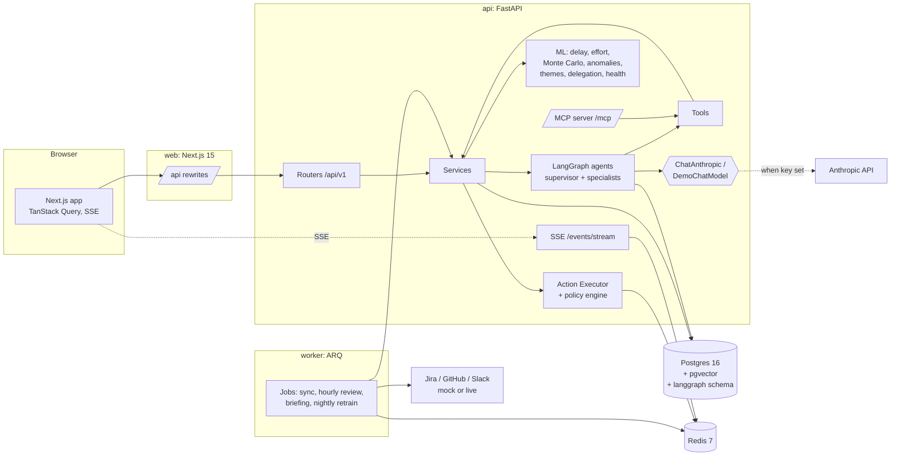
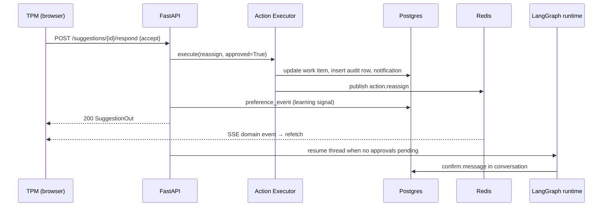

# Architecture

## Layers

- **Routers** (`api/v1`) are thin: parse, check RBAC through dependencies, call a service.
- **Services** (`services/`) hold business logic and never import FastAPI. All program-state
  writes go through `services/actions.py` (the Action Executor), which validates, checks RBAC
  and the autonomy policy, applies the change, audits it and publishes a domain event.
- **Repository** (`db/repository.py`) scopes every query to the tenant.
- **ML** (`ml/`) is pure functions over `ProgramData` frames; `services/ml_jobs.py` persists.
- **Agents** (`agents/`) are LangGraph graphs (see `docs/AGENTS.md`).
- **Connectors** (`connectors/`) implement typed interfaces with mock and live adapters.

## Request lifecycle: approving a rebalance

## Deployment

- Local: `make dev` (infra in Docker, processes with reload) or `make up` / `make demo`
  (everything in Docker Compose).
- Kubernetes: `deploy/helm/twinpm` (API with migration init container, worker, web, shared
  ReadWriteMany volume for the model registry, ingress with SSE buffering off, probes and
  resource limits; `values-prod.yaml` for production).

## Observability

OpenTelemetry traces (FastAPI, SQLAlchemy, httpx) export when `OTEL_EXPORTER_OTLP_ENDPOINT` is
set; structlog JSON logs carry request IDs; Prometheus metrics at `/metrics`
(`twinpm_http_*`, `twinpm_llm_*`); LLM telemetry in `llm_calls` with an admin view.
